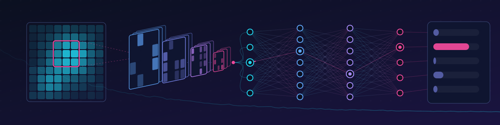

  

  
  

Hi! I am an MSc student in Image Analysis and Machine Learning, interested in deep learning for medical image segmentation, image enhancement and clinical prediction

- 🔬 **Currently:** *I am building an Assisted segmentation platform*
- 🎯 **Open to:** ML roles in medical image analysis, image enhancement and projects that have impact on the world.

## 🩻 Selected work

| Project | What it does |
|---|---|
| [**project-one**](https://github.com/nikochao/radiology_infrastructure_ref_segm) | Assisted Segmentation 3D slicer extension with back-end infrastructure to support collaboration | 
| [**project-two**](https://github.com/agouletas/multimodal-nsclc) | Non small lung cancer - segmentation and prediction |
| [**project-three**]((https://github.com/P4ul-A/Mini-Project)) | Application of classical image analysis techniques | 

## 🛠️ Toolkit

